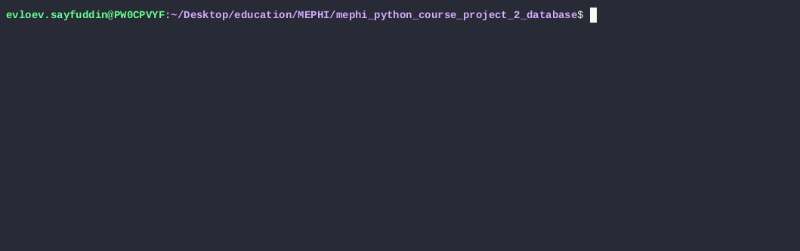

# project-2_EVLOEV_M26-555

## Отладка во время разработки
```
uv sync
uv run python -m primitive_db.main
```

## Сборка, установка и запуск
```
uv build
uvx twine check dist/*
uv tool install dist/*.whl
```
Запуск
```
database
```

## Функционал

### Управление таблицами
- create_table <имя_таблицы> <столбец1:тип> <столбец2:тип> .. - создать таблицу
- list_tables - показать список всех таблиц
- drop_table <имя_таблицы> - удалить таблицу
- exit - выход из программы
- help - справочная информация

### Операции с данными
- insert into <имя_таблицы> values (<значение1>, <значение2>, ...) - создать запись.
- select from <имя_таблицы> where <столбец> = <значение> - прочитать записи по условию.
- select from <имя_таблицы> - прочитать все записи.
- update <имя_таблицы> set <столбец1> = <новое_значение1> where <столбец_условия> = <значение_условия> - обновить запись.
- delete from <имя_таблицы> where <столбец> = <значение> - удалить запись.
- info <имя_таблицы> - вывести информацию о таблице.

### Демо

#### Опреации с базой данных


#### Опреации с таблицами


