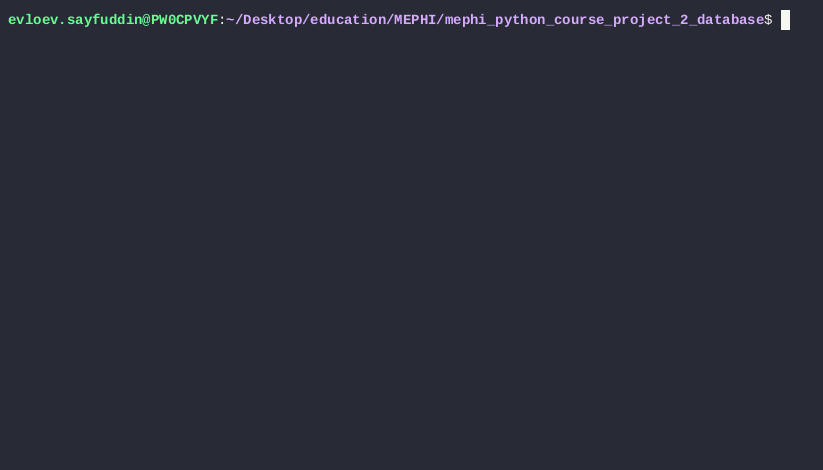

# project-2_EVLOEV_M26-555

## Отладка во время разработки
```
uv sync
uv run python -m primitive_db.main
```

## Сборка и установка
```
uv build
uvx twine check dist/*
uv tool install dist/*.whl
```
Run
```
database
```

## Управление таблицами
- create_table <имя_таблицы> <столбец1:тип> <столбец2:тип> .. - создать таблицу
- list_tables - показать список всех таблиц
- drop_table <имя_таблицы> - удалить таблицу
- exit - выход из программы
- help - справочная информация

### Демо

